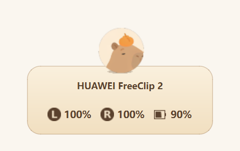
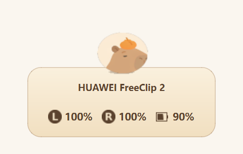
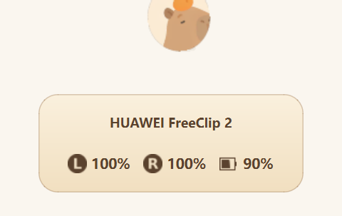
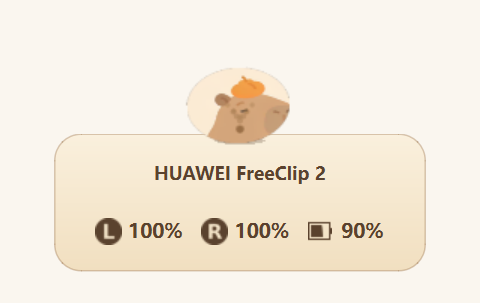
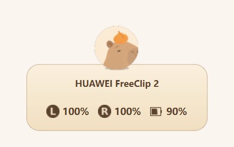
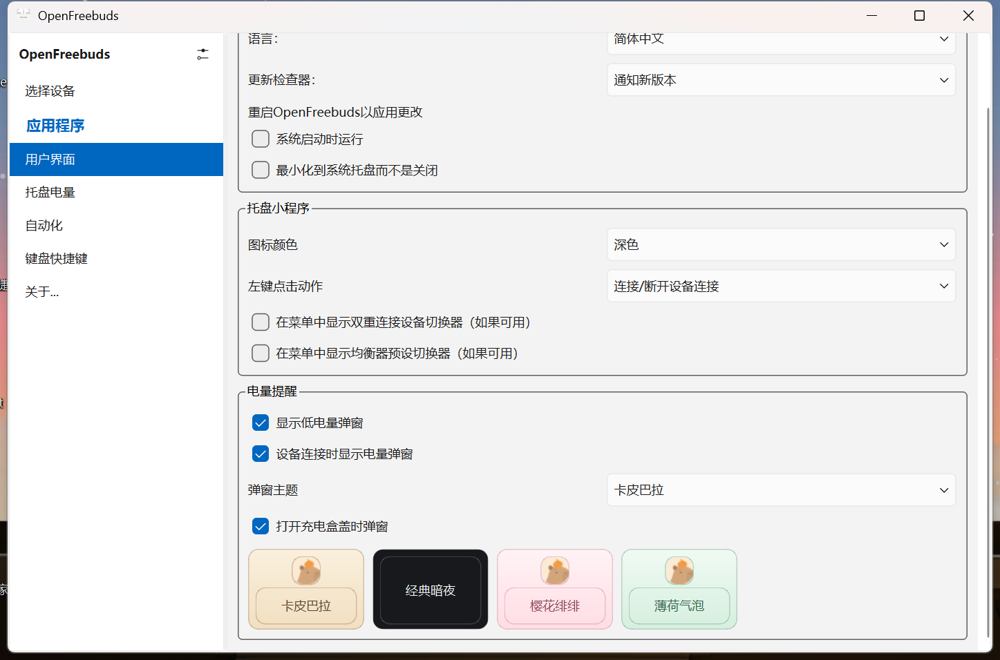
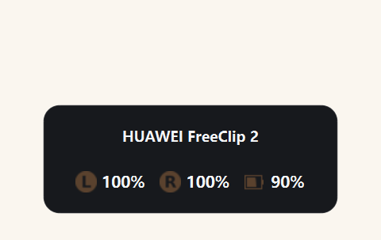
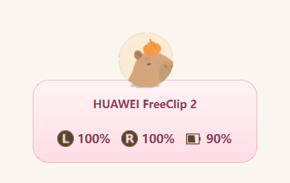
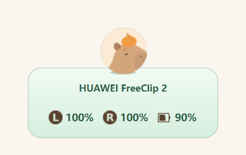
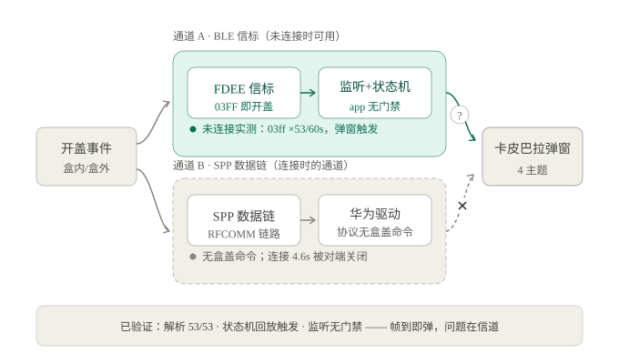

# 🦫 卡皮巴拉弹窗 · OpenFreebuds 魔改版

> 华为 FreeClip 2 连在联想笔记本上。开盖的那一秒，一只头戴橘子的卡皮巴拉从屏幕顶端跳出来，顶着你的三格电量向你问好。

非华为电脑连华为耳机，系统级弹窗是想都不用想的。OpenFreebuds 是社区最好的开源替代，但它自带的弹窗朴素得像系统通知——于是有了这个魔改版：**把弹窗变成一场 4.4 秒的卡皮巴拉马戏。**

本项目基于 [melianmiko/OpenFreebuds](https://github.com/melianmiko/OpenFreebuds)（GPL-3.0）深度定制，信标协议参考 [LibreBuds](https://github.com/librebuds/librebuds)。与华为无任何关联，逆向仅用于互操作。



---

## ✨ 功能亮点

- **开盖弹窗**：监听耳机充电盒的 BLE 广播（FDEE 信标），识别"开盖"状态，盒内盒外都能触发
- **连接弹窗**：设备连上时同样来一段表演，电量 freshly squeezed
- **四套主题**：卡皮巴拉 / 经典暗夜 / 樱花绯绯 / 薄荷气泡，设置页里**看图点选**，所见即所得
- **全中文界面**：248 条翻译条目，一个英文都不剩下
- **动画有物理**：下蹲蓄力、腾空 44px、落地扬尘、影子缩放、阻尼摇晃——迪士尼十二原则照进 Qt 控件

## 🎪 一只卡皮巴拉的 4.4 秒

整套动作是一条精心编排的时间轴（`low_battery_overlay.py` 里有全部参数，欢迎围观）：

| 预备下蹲<br>`700–950ms` | 腾空一跃<br>`950–1590ms` | 落地压扁<br>`1590–1830ms` | 阻尼摇晃<br>`1830–2700ms` | 落定悬浮<br>`2500ms+` |
|:---:|:---:|:---:|:---:|:---:|
| 起跳前先蹲，压缩蓄力 | 抛物线腾空 44px，空中倾身 9°，速度映射拉伸 | 落地瞬间压扁，五粒灰尘错峰淡出 | 阻尼弹簧摇晃，幅度指数衰减 | 每 1.9 秒惬意小跳一下，±4px 呼吸浮动 |
|  |  |  |  |  |

细节控福利：卡片不是背景板——卡皮巴拉起跳时盒子会被"踩"下沉，落地时阻尼回弹，两者是一套连携动作。

## 🎨 四套主题，设置页看图点选

打开 `用户界面 → 电量提醒 → 弹窗主题`，四张卡片就是四套弹窗的微缩预览，点一下即刻生效：



| 卡皮巴拉 | 经典暗夜 | 樱花绯绯 | 薄荷气泡 |
|:---:|:---:|:---:|:---:|
|  |  |  |  |

暗夜主题不跳舞（energy=0）——有人半夜不想被一只水豚吵醒，我懂的。

## 📡 开盖检测是怎么做到的

华为耳机开盖时会通过 BLE 广播一个 FDEE 信标，其中 flags 字段 `03FF` 就是"盒盖已打开"。本项目监听系统广播、解析信标、跑一个带 20 秒冷却的状态机，确认开盖事件后触发弹窗：



踩过的坑，都写在代码注释里：

- 信标解析器用 LibreBuds 的 67 条真实硬件抓包向量做过回归（53/53 通过）
- 状态机回放真实信标流验证过触发时机，不是纸上谈兵
- 只对本机学习过的 model id 弹窗（`000167` = FreeClip 2），隔壁工位的华为耳机不会误触
- 耳机休眠时停止广播属正常物理行为，此时需要先开盖唤醒——这不是 bug，是节电

## 🚀 快速开始

需要 Python 3.14（对，3.14，项目要求 `<3.15,>=3.14`）：

```bash
# 安装依赖（PDM 管理）
pdm install

# 直接跑源码
openfreebuds_qt
```

打包 Windows 便携版单文件：

```bash
just win32_portable
# 产物在 dist/，约 60MB，双击即用，配置在 %APPDATA%\openfreebuds
```

连接前先在系统蓝牙里配对耳机，然后启动 app——托盘图标会显示连接状态。首次连接后建议去设置页把玩一下四套主题。

## 🗺️ 路线图

- [x] 连接弹窗 + 开盖弹窗（BLE 信标）
- [x] 四套主题 + 应用内可视化切换
- [x] 简体中文化
- [ ] 连接状态下改走 SPP 协议事件触发（信标在数据链建立后会被耳机撤下，规划中）
- [ ] 盒外开盖场景的信号源补全

## 💚 致谢

- [OpenFreebuds](https://github.com/melianmiko/OpenFreebuds) —— 本项目的地基
- [LibreBuds](https://github.com/librebuds/librebuds) —— FDEE 信标协议与真实测试向量
- 卡皮巴拉头像由 AI 生成并手绘修饰，头上的橘子是灵魂

## 📄 License

跟随上游，[GPL-3.0](LICENSE)。原版权信息保留在文件头，尊重每一个写代码的人。
